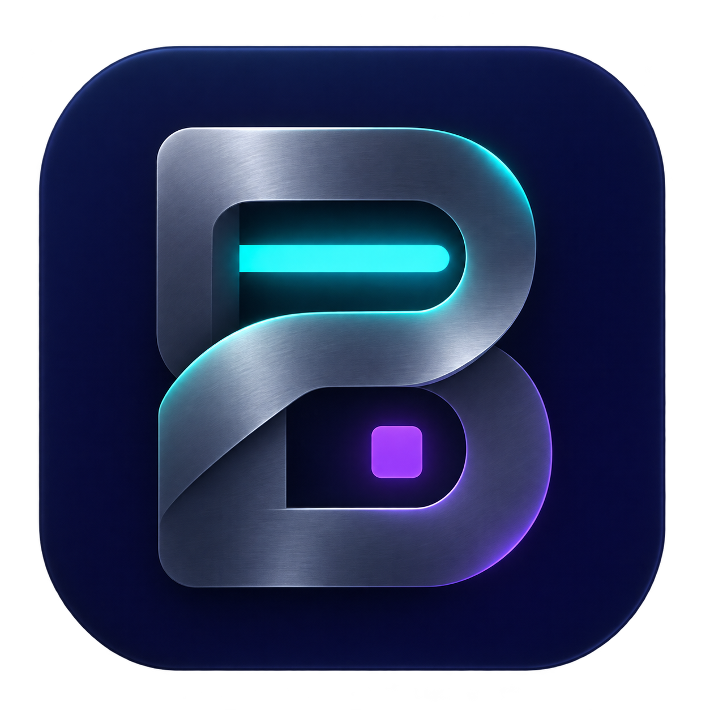
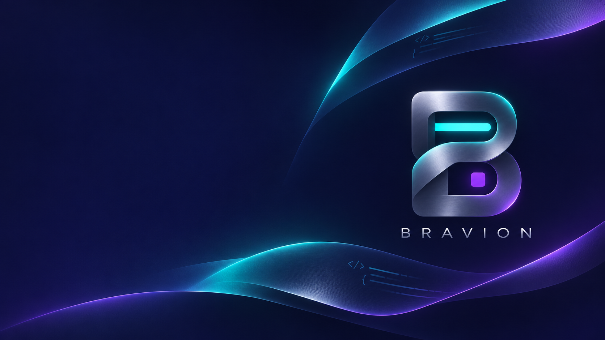

<div align="center">



# Bravion OS

### A Linux workspace for developers building with AI.

Built from source with **Linux From Scratch**. A **COSMIC + Wayland** desktop, a **Rust app store**, and a foundation for coding, automation, and robotics.

[](https://github.com/hckmseduardo/bravion-os/actions/workflows/checks.yml)


**[Português](README.pt-BR.md)** · **[Build guide](docs/building.md)** · **[Installation](docs/installation.md)** · **[Contributing](CONTRIBUTING.md)**

</div>



## Your system. Your tools. Your automation.

Bravion brings an AI-oriented development workspace to a Linux system built from source. Start with a usable desktop, connect to your network, and choose the tools you need. Keep your projects, terminal, editor, browser, and AI clients in one environment.

The project began on Raspberry Pi 4 and expanded to Apple Silicon virtual machines. An Intel/AMD PC edition is under development. The long-term direction is a practical base for AI-assisted software development, automation, and robotics; **ROS, robot control stacks, and real-time guarantees are not included today**.

> **Development snapshot:** the ARM64 images have been generated and tested in an existing Parallels VM. This repository provides a single-command, checkpointed image pipeline. A clean source-to-image validation is in progress; do not treat it as an end-to-end verified release yet. The AMD64 edition is not a released image.

## What is inside

| Component | Purpose |
| --- | --- |
| Linux From Scratch + systemd | A Linux base compiled from source |
| COSMIC + Wayland | Desktop, workspaces, settings, terminal, files, and editor |
| Bravion Store, written in Rust | Visual app cards, install/retry/open actions, progress, and installation logs |
| Git, Rust, Node.js, and npm | Developer tools available in the ARM64 desktop image |
| Brave | Preinstalled system Flatpak, including its runtime, Wayland and a VM rendering fallback |
| Flatpak | Flathub and the official COSMIC repository configured for COSMIC Store |
| PipeWire + WirePlumber | Audio and microphone session management |
| NetworkManager | Ethernet and Wi-Fi configuration |
| OpenSSH | Remote terminal access using SSH keys |

The store offers Codex, Claude Code, Grok Build, VS Code, and optional desktop clients. Availability and authentication depend on each publisher. **Installing a client does not include a subscription, API credit, or account.** The store selects ARM64 or AMD64 downloads according to the guest architecture; architecture selection has regression tests. Installation on the unfinished AMD64 image remains to be tested.

## Platform status

| Target | Architecture | Current state |
| --- | --- | --- |
| Raspberry Pi 4, USB boot | ARM64 / AArch64 | 0.11.1 image generated; physical boot of this revision still needs verification |
| Parallels on Apple Silicon | ARM64 / AArch64 | 0.11.1 image generated; extended monitors and correct clicks confirmed in the working VM |
| Intel and AMD 64-bit PCs | x86-64 / AMD64 | Toolchain build in progress; **no bootable release yet** |
| UTM on Apple Silicon | ARM64 / AArch64 | Historical development target; current revision not validated |

**AMD64 means x86-64 for both Intel and AMD processors. It does not mean ARM64.** The Raspberry Pi image and the Apple Silicon VM image have different boot requirements and are not interchangeable.

## Try an image

The latest locally generated ARM64 revision is **0.11.1**:

| Artifact | Compressed size | Intended use |
| --- | --- | --- |
| `bravion-os-0.11.1-raspberry-pi4-arm64.img.xz` | 1.06 GB | Flash a USB drive with Raspberry Pi Imager → Use custom |
| `Bravion-OS-0.11.1-Parallels-arm64.pvm.zip` | 1.63 GB | Extract the `.pvm` and open it in Parallels on an Apple Silicon Mac |

These are measured build results, **not files stored in this Git repository**. There are no hosted binary release assets yet. When available, downloads will be published on the [Releases page](https://github.com/hckmseduardo/bravion-os/releases), with SHA-256 checksums and validation notes.

Compressed download size reflects the packaged contents. The Parallels guest has a larger expanding virtual disk for installation and use; that capacity is not the download size.

Read the [installation guide](docs/installation.md) before flashing or importing an image. First boot creates your own account and password. There is no default login password and no preconfigured Wi-Fi password.

## What changed in 0.11.1

- Corrected COSMIC's absolute pointer mapping for the **Parallels Virtual Mouse**, so it addresses the complete extended desktop and selects the correct output for clicks.
- Preserved a tested two-display layout: 1920×1080 per display, positioned side by side.
- Added the VirtIO VSOCK kernel module required by the Parallels Tools daemon.
- Disabled the vendor graphical Tools client whose GNOME/KDE resolution integration did not configure COSMIC reliably. The Tools daemon remains usable.
- Used shared-memory screencopy for Workspaces to avoid the observed VirtIO DMA-BUF protocol failure.
- Included the user's local CLI directory in interactive shell `PATH`.

The pointer change is scoped to the named Parallels virtual device. It does not replace the mapping for physical Raspberry Pi input devices. See [the correction source and tests](patches/cosmic/absolute_pointer.rs).

## Build and inspect

Start by inspecting the source and running the lightweight checks:

```sh
git clone https://github.com/hckmseduardo/bravion-os.git
cd bravion-os
make check
```

`make check` requires Python 3 and Bash. If `rustc` is available, it also runs the standalone pointer regression tests. To test the Rust store, use Linux with the GTK 3 development libraries installed:

```sh
cargo test --locked --manifest-path ai-tools/Cargo.toml
```

### One command, from sources to image

Install Docker, then choose a target and a dedicated storage directory:

```sh
# Raspberry Pi 4, USB boot
./bravion build --target pi4-arm64 --storage /path/to/build-pi4

# Apple Silicon Mac with Parallels installed
./bravion build --target parallels-arm64 --storage /path/to/build-parallels

# Intel / AMD 64-bit PC
./bravion build --target amd64 --storage /path/to/build-amd64
```

The command creates the isolated builder, downloads and verifies sources, builds LFS and the desktop, applies corrections, compiles the Rust store, packages a content-sized disk, compresses it, and runs integrity and boot checks. **No manual package compilation or intermediate image assembly is required.** Outputs appear in `<storage>/outputs`; status is available through:

```sh
./bravion status --storage /path/to/build-pi4
```

Re-run the same build command to resume completed stages. A storage directory belongs to one target. Corrections limited to stages that have never started can resume automatically. An incomplete LFS stage also validates individual package checkpoints; compiled or started recipes remain protected. Changes to verified prior inputs require a new directory. Start with `--jobs 1` on memory-constrained machines. Allow **at least 80 GiB free disk space** and preferably 8–16 GiB of builder RAM. Emulated builds can take substantially longer than native builds.

Docker must support privileged Linux containers and the requested architecture. Parallels builds obtain the official ARM64 Tools ISO from the local Mac installation, or from `--tools-iso /path/to/prl-tools-lin-arm.iso`; this proprietary input is not in the repository. Flashing/importing and first-boot account setup happen after generation.

See the [build guide](docs/building.md) for prerequisites, checkpoints, logs, and validation scope. Pinned inputs and automated generation do not imply bit-for-bit reproducibility. Brave and its runtime are provisioned from the current signed Flathub refs at configuration time; `/usr/share/bravion/flatpak-build.txt` records the installed commits. Fresh builds can therefore contain different Flatpak versions.

## Repository map

```text
ai-tools/             Rust source for Bravion Store
branding/             Original Bravion artwork and identity installers
build/                LFS ARM64 bootstrap, source fetching, kernel, firmware
build/scripts/        Generated LFS package installation commands
research/             LFS manifests and license references
desktop/              Desktop integration and image packaging
desktop/generated/    Package scripts recovered from the working desktop build
patches/cosmic/        Extended-display pointer fix, tests, and display layout
experimental/amd64/   Separate x86-64 LFS bootstrap; not a release image
scripts/              Repository checks and patch application
docs/                 Installation, build, and release guidance
```

Source archives, build outputs, personal VM bundles, accounts, credentials, and proprietary installers are excluded from version control. Parallels Tools must be obtained from the user's own Parallels installation; they are not redistributed in this source repository.

## Validation and limits

For 0.11.1, the ARM64 compositor compiled, all **five pointer regression tests passed**, both image filesystems passed read-only checks, the converted Parallels disk matched its raw source, and the ZIP/XZ archives passed integrity checks. The user confirmed extended displays and aligned mouse clicks in the existing Parallels VM.

A fresh-account boot of the newly packaged release and a physical Pi boot of 0.11.1 have **not** been re-tested end to end. Hardware support is limited to what has actually been exercised. No secure-boot, general PC compatibility, or complete upstream test-suite claim is made.

## Help shape Bravion

Useful contributions include fresh-install testing, Wi-Fi and audio reports, AMD64 build fixes, architecture-aware application downloads, and clearer build instructions. Start with [CONTRIBUTING.md](CONTRIBUTING.md). When reporting a bug, include the image revision, architecture, hardware or hypervisor, reproduction steps, and relevant logs with personal data removed.

## Credits and licenses

Bravion builds on [Linux From Scratch](https://www.linuxfromscratch.org/lfs/), [Beyond Linux From Scratch](https://www.linuxfromscratch.org/blfs/), [COSMIC](https://github.com/pop-os/cosmic-epoch), Raspberry Pi's kernel/firmware work, and the wider free software community.

Project-authored build tooling is provided under the [MIT license](LICENSE). COSMIC-derived patches retain GPL-3.0-only licensing; LFS-derived commands and other third-party components retain their own notices. See [THIRD_PARTY.md](THIRD_PARTY.md). Application and vendor names identify their respective products and do not imply endorsement. The Bravion artwork is original AI-assisted artwork; no fictional character art is included.
