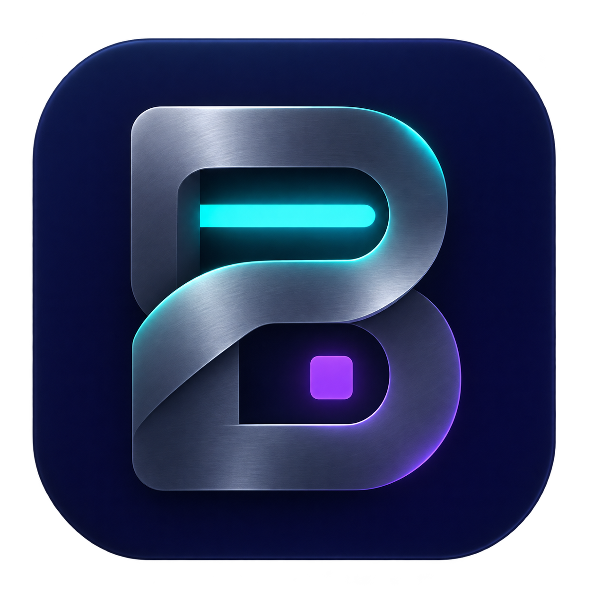
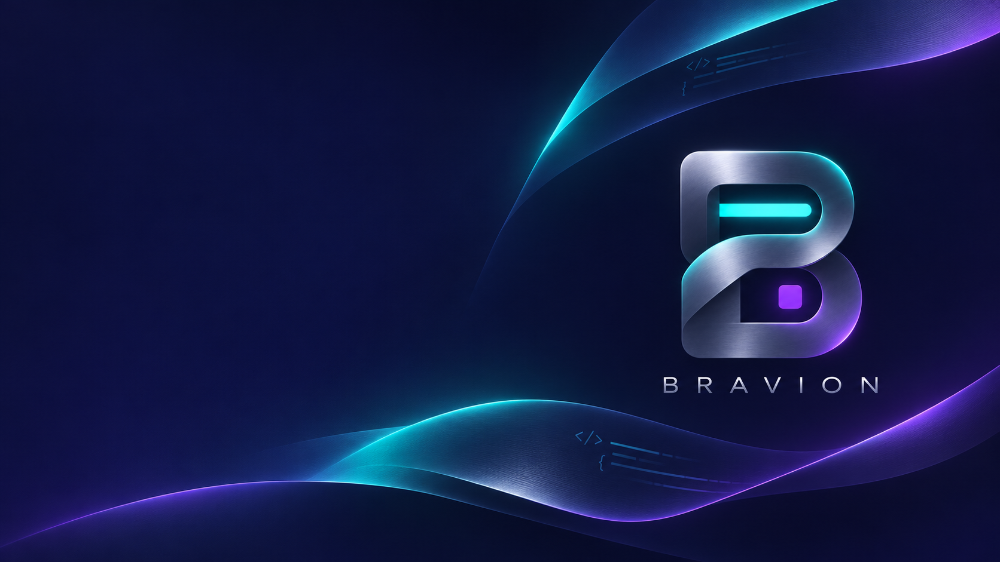

<div align="center">



# Bravion OS

### Linux para desenvolvedores que constroem com IA.

**Linux From Scratch · COSMIC / Wayland · Store em Rust**

[English](README.md) · [Como gerar](docs/building.md) · [Instalação](docs/installation.md) · [Validação](docs/validation.md)

</div>



O Bravion reúne terminal, editor, navegador e ferramentas de IA em um ambiente voltado ao desenvolvimento, à automação e à robótica. A base Linux e o desktop são construídos a partir das fontes; alguns componentes, como Rust, Node.js e Brave, usam distribuições binárias oficiais verificadas. O projeto ainda é experimental: não inclui ROS nem garantias de tempo real.

## O que vem na imagem

- Desktop **COSMIC com Wayland**, Workspaces, terminal, arquivos e COSMIC Edit.
- **Bravion Store em Rust**, com cartões de aplicativos, filtros, instalação, progresso, abertura e mensagens de erro.
- **Git, Rust, Node.js e npm** para desenvolvimento.
- **Brave** e suporte a **Flatpak**.
- **PipeWire e WirePlumber** para áudio e microfone.
- **NetworkManager** para Ethernet e Wi-Fi, mais **OpenSSH**.
- Assistente inicial para criar sua conta e configurar a rede, sem senha padrão.

A Store oferece ferramentas como Codex, Claude Code, Grok Build e VS Code, além de clientes desktop opcionais conforme a disponibilidade dos fornecedores. A instalação não inclui contas, assinaturas ou créditos de API.

## Plataformas

| Destino | Arquitetura | Situação |
| --- | --- | --- |
| Raspberry Pi 4 por USB | ARM64 | Imagem 0.11.1 gerada; teste físico dessa revisão ainda pendente |
| Parallels no Apple Silicon | ARM64 | Imagem gerada; monitores estendidos e cliques alinhados confirmados na VM de desenvolvimento |
| PCs Intel e AMD de 64 bits | x86-64 / AMD64 | Compilação em andamento; sem release inicializável validada |
| UTM no Apple Silicon | ARM64 | Ambiente histórico de desenvolvimento; revisão atual não validada |

**AMD64 e x86-64 são nomes da mesma arquitetura de 64 bits para Intel e AMD. ARM64 é outra arquitetura.** As imagens do Pi e do Parallels têm requisitos de boot diferentes.

## Geração automática

Com Python 3 e Docker instalados:

```sh
git clone https://github.com/hckmseduardo/bravion-os.git
cd bravion-os
./bravion check
./bravion build --target pi4-arm64 --storage /caminho/absoluto/build-pi4
```

Outros destinos:

```sh
./bravion build --target parallels-arm64 --storage /caminho/absoluto/build-parallels
./bravion build --target amd64 --storage /caminho/absoluto/build-amd64
```

Um comando prepara o ambiente isolado, baixa e verifica fontes, compila o sistema e o desktop, aplica os ajustes, gera a imagem, compacta e executa verificações de integridade e boot. Não é necessário compilar pacotes ou montar imagens manualmente.

Use um diretório exclusivo por arquitetura e revisão de fontes, com **pelo menos 80 GiB livres**. Prefira SSD e 8–16 GiB de RAM no Docker. A compilação emulada de AMD64 em um Mac ARM pode demorar bastante. `--jobs 1` reduz a pressão de memória.

O destino Parallels encontra o ISO oficial ARM64 dos Tools na instalação local do Mac; em outro ambiente, informe `--tools-iso /caminho/prl-tools-lin-arm.iso`. Esse componente proprietário não está no repositório.

```sh
./bravion status --storage /caminho/absoluto/build-pi4
```

Os resultados ficam em `<storage>/outputs`. Repetir o mesmo comando retoma etapas concluídas. Correções restritas a etapas ainda não iniciadas podem ser retomadas automaticamente, após comparar os dados de entrada. Mudanças que afetem etapas já iniciadas exigem outro diretório.

**A execução completa do zero ainda está em validação.** Testes locais aprovados e imagens empacotadas a partir de um sistema preparado não comprovam, sozinhos, uma compilação completa das fontes. Consulte o [registro de validação](docs/validation.md).

## Imagens e tamanhos

As imagens ARM64 0.11.1 geradas localmente tiveram aproximadamente **1,06 GB** no Pi e **1,63 GB** no Parallels, compactadas. Esses arquivos não estão no Git nem publicados como assets de release. Os tamanhos não prometem o tamanho das próximas versões.

A imagem compactada representa o conteúdo; a capacidade disponível no disco virtual pode ser maior. No Pi, use **Raspberry Pi Imager → Use custom**. No Parallels, extraia o ZIP e abra o `.pvm`. Veja o [guia de instalação](docs/installation.md).

## Monitores e mouse

O Bravion corrige o mapeamento absoluto do dispositivo **Parallels Virtual Mouse** para toda a área do desktop estendido, preservando o mapeamento dos demais dispositivos. O cliente gráfico dos Tools, incompatível com a configuração COSMIC observada, fica desativado; o daemon dos Tools permanece separado. O Workspaces usa screencopy em memória compartilhada para evitar a falha observada com VirtIO/DMA-BUF.

## Participar

Ajude com builds limpos, instalações novas, suporte de hardware, áudio, Wi-Fi e testes AMD64. Consulte [CONTRIBUTING.md](CONTRIBUTING.md) e informe sempre o que foi realmente testado.

O trabalho original do Bravion usa [MIT](LICENSE), com exceções e componentes de terceiros descritos em [THIRD_PARTY.md](THIRD_PARTY.md). As modificações derivadas do COSMIC preservam GPL-3.0-only; kernel, firmware e aplicativos mantêm suas próprias condições. A arte Bravion é original e não contém personagens de franquias.
